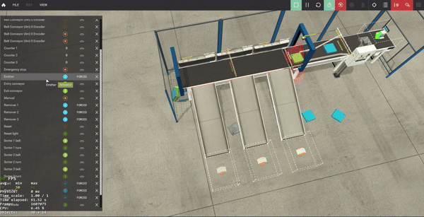
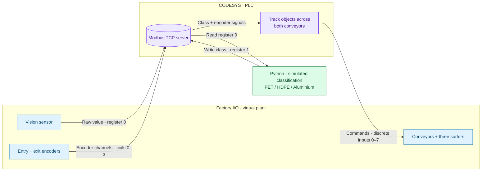
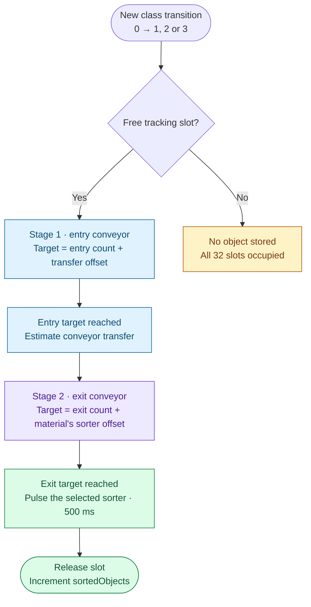

# Recyclable Material Sorting Simulation

A conveyor sorting simulation built with **Factory I/O, CODESYS and Python**, demonstrating simulated material classification, Modbus TCP communication and encoder-based object tracking. Blue, green and metal objects represent **PET plastic, HDPE plastic and aluminium**, each routed to its own sorter.



## Project overview

The simulation connects a virtual factory to a software PLC and a Python classification script. It demonstrates the complete path from object detection to timed sorter actuation, including independent tracking across two conveyors and up to 32 object slots.

The virtual plant is adapted from Factory I/O's built-in [Sorting Station example](https://docs.factoryio.com/manual/scenes/sorting-station/). This project adds the CODESYS PLC program, encoder-based tracking and Python material-classification integration. See [References and acknowledgements](#references-and-acknowledgements) for the scene credit and tools used.

| Factory I/O object | Sensor value | Simulated material | Class ID | Destination |
|---|---:|---|---:|---|
| Blue raw material | 1 | PET plastic | 1 | Sorter 1 |
| Green raw material | 4 | HDPE plastic | 2 | Sorter 2 |
| Metal raw material | 7 | Aluminium | 3 | Sorter 3 |
| No recognised object | Any other value | Unknown / no object | 0 | No new object registered |

## Repository contents

```text
recyclable-material-sorting-simulation/
├── README.md
├── LICENSE
├── requirements.txt
├── python/
│   └── material_classification_simulation.py
├── codesys/
│   ├── source/
│   │   ├── FIO.gvl
│   │   ├── PLC_PRG_declaration.st
│   │   └── PLC_PRG_implementation_tracking.st
│   └── projects/
│       └── README.md
├── factoryio/
│   └── scenes/
│       └── recyclable-material-sorting.factoryio
└── media/
    └── sorting-demo.gif
```

The commented PLC source and complete setup walkthrough are included below. Create the CODESYS controller project from these sources using Sections 3–7; see [CODESYS projects](codesys/projects/README.md) for the intended project filename. Software installers are downloaded from the vendors and are excluded from version control.

## Contents

- [Project overview](#project-overview)
- [Repository contents](#repository-contents)
- [How it works](#how-it-works)
  - [System architecture](#system-architecture)
  - [Object tracking](#object-tracking)
- [Setup](#setup)
  - [1. Install](#1-install)
  - [2. Prepare the Factory I/O scene](#2-prepare-the-factory-io-scene)
  - [3. Set up CODESYS and its Modbus TCP server](#3-set-up-codesys-and-its-modbus-tcp-server)
  - [4. Configure the Factory I/O Modbus TCP/IP Client](#4-configure-the-factory-io-modbus-tcpip-client)
- [Implementation](#implementation)
  - [5. FIO Global Variable List](#5-codesys--fio-global-variable-list)
  - [6. PLC_PRG Declaration](#6-codesys--plc_prg-declaration)
  - [7. PLC_PRG Implementation](#7-codesys--plc_prg-implementation)
  - [8. Python classification script](#8-python--material_classification_simulationpy)
- [Calibration and verification](#calibration-and-verification)
  - [9. Calibrate the offsets](#9-calibrate-the-offsets)
  - [10. End-to-end verification](#10-end-to-end-verification-one-object-at-a-time)
  - [Troubleshooting](#troubleshooting)
- [References and acknowledgements](#references-and-acknowledgements)
- [Licence](#licence)

## How it works

Factory I/O simulates the physical conveyor, vision sensor, two encoders and three sorter arms. CODESYS acts as the PLC: it reads sensor tags, tracks each detected object across the two conveyors, and commands the sorter. Python simulates material classification by mapping a Modbus sensor value to PET plastic, HDPE plastic or aluminium, then writing the class back to the PLC. The colours and metal appearance are stand-ins for these materials; this version uses no camera images or trained AI/CV model.

### System architecture

Factory I/O supplies sensor values to the PLC. Python reads the vision value and returns a material class; the PLC uses that class and encoder movement to time the sorter commands.



The vision value and class result use **holding registers 0 and 1**. Factory I/O writes the sensor data and reads the PLC's actuator commands; Python only exchanges classification data with the PLC.

### Object tracking

Each detected object occupies one of **32 tracking slots**. Its position is tracked first with the entry conveyor's counter, then with the exit conveyor's counter. The transfer point is estimated from counts.



The **500 ms** pulse is configurable through `sorterTurnDuration`. `sortedObjects` counts sorter commands issued; it does not confirm physical diversion.

This is a **simulation prototype**, not a validated industrial positioning system. Encoder transitions can be missed over Modbus, and the entry-to-exit handoff is estimated from counts rather than confirmed by a transfer sensor.

## Setup

### 1. Install

- [Factory I/O](https://factoryio.com/), using its built-in **Sorting Station** scene (not Sorting by Height) and a licence/edition with the Modbus TCP/IP Client driver.
- [CODESYS Development System](https://www.codesys.com/) and **CODESYS Control Win V3 x64** runtime, available through the CODESYS website/store.
- [Python](https://www.python.org/downloads/), then `python -m pip install -r requirements.txt` from the repository root. The dependency is pinned to `pymodbus==3.6.9`.

### 2. Prepare the Factory I/O scene

1. Open the supplied [recyclable material sorting scene](factoryio/scenes/recyclable-material-sorting.factoryio), or start from the built-in **Sorting Station** scene to reproduce it manually.
2. In edit mode (`F5`), right-click the **Emitter** → **Part to Emit**, and select blue, green and metal raw-material objects as appropriate for your scene/emitter setup.
3. Simulated classes: **Blue → PET plastic (1) → Sorter 1; Green → HDPE plastic (2) → Sorter 2; Metal → Aluminium (3) → Sorter 3**.
4. Retain the original two conveyors and three turn/belt sorter mechanisms. Save a copy of the modified `.factoryio` scene as `recyclable-material-sorting.factoryio`.

**Supplied scene configuration:** The saved scene retains its original layout and driver assignments. Its Modbus client currently assigns digital sensor points to control-panel tags rather than the four encoder channels, and digital output 7 repeats Sorter 2 belt. Complete the mapping in Section 4 before running the documented PLC source, including the four encoder inputs and **Sorter 3 belt at output 7**. The saved scene is a starting point for this setup, rather than a preconfigured match for the source below.

**Optional future pusher experiment (not used by the code below):** In edit mode, open the parts palette (`P`), choose **Light Load Parts → Pusher**, place it beside the conveyor, and test its actuator with manual I/O forcing (`O`, where supported). This requires a new PLC tag and Modbus mapping before automated control; do not substitute it for the current sorter belts without updating the program.

### 3. Set up CODESYS and its Modbus TCP server

1. Install and start **CODESYS Control Win V3 x64**. In CODESYS, create a **Standard Project** for that controller, choosing **Structured Text (ST)** for `PLC_PRG`.
2. Under **Application**, add a **Global Variable List (GVL)** named exactly `FIO`. Paste Section 5 (or [FIO.gvl](codesys/source/FIO.gvl)) into it. Paste Sections 6 and 7 (or [the declaration](codesys/source/PLC_PRG_declaration.st) and [implementation](codesys/source/PLC_PRG_implementation_tracking.st)) into `PLC_PRG` **Declaration** and **Implementation** respectively. Save the project as `recyclable-material-sorting.project` in `codesys/projects/`.
3. In the **Devices** tree, right-click the **controller (Device)** → **Add Device** → **Ethernet**. Then right-click **Ethernet** → **Add Device** → **Modbus TCP Slave Device / Modbus TCP Server Device** (wording varies by CODESYS version). **Do not add a Modbus TCP Client** on the PLC side: Factory I/O is the client.
4. Open **Ethernet → General** and select the network interface used by the PLC runtime. Open **Modbus TCP Server Device → General** and set **Server port = 502**.
5. Enable **Discrete Bit Areas** so coils and discrete inputs are distinct. Allocate at least **4 coils**, **8 discrete inputs**, and **2 holding registers**; ensure holding registers can be written by the clients (Factory I/O and Python). Use starting offsets **0**. The exact register mapping options differ by CODESYS version.
6. Open the server device's **I/O Mapping** tab. For each exposed address, enter/select the corresponding `FIO` variable from the table below. Verify the direction: **Factory I/O writes encoder coils and the vision register; CODESYS supplies actuator discrete inputs**. If a mapping cannot be entered because of read/write direction, inspect the server's **General** options and process-image configuration rather than reversing the sensor and actuator assignments.
7. Open **Application → Task Configuration → MainTask** and ensure `PLC_PRG` is called cyclically. **Build (`F11`) → Online → Login** (accept download) → **Start (`F5`)**. If TCP port 502 is already occupied by another server, stop the conflicting service first.

Official reference: [Factory I/O — CODESYS Modbus TCP setup (SP16+)](https://docs.factoryio.com/tutorials/codesys/setting-up/codesys-mb-sp16/).

#### Modbus address map (zero-based)

| Modbus area | Address | Factory I/O tag | CODESYS variable |
|---|---:|---|---|
| Coil | 0 | Entry encoder A | `FIO.iEncoderA` |
| Coil | 1 | Entry encoder B | `FIO.iEncoderB` |
| Coil | 2 | Exit encoder A | `FIO.iExitEncoderA` |
| Coil | 3 | Exit encoder B | `FIO.iExitEncoderB` |
| Holding register | 0 | Vision sensor | `FIO.materialSensorValue` |
| Holding register | 1 | Python class result (Python writes directly) | `FIO.pythonMaterialClass` |
| Discrete input | 0 | Entry conveyor | `FIO.oEntryConveyor` |
| Discrete input | 1 | Exit conveyor | `FIO.oExitConveyor` |
| Discrete input | 2 | Sorter 1 turn | `FIO.oSorter1Turn` |
| Discrete input | 3 | Sorter 1 belt | `FIO.oSorter1Belt` |
| Discrete input | 4 | Sorter 2 turn | `FIO.oSorter2Turn` |
| Discrete input | 5 | Sorter 2 belt | `FIO.oSorter2Belt` |
| Discrete input | 6 | Sorter 3 turn | `FIO.oSorter3Turn` |
| Discrete input | 7 | Sorter 3 belt | `FIO.oSorter3Belt` |

`FIO` has `{attribute 'qualified_only'}`, so always use the `FIO.` prefix. Holding register 1 is **not** a Factory I/O scene tag: it is written by the Python script.

### 4. Configure the Factory I/O Modbus TCP/IP Client

1. Open the **Sorting Station** scene. Choose **File → Drivers (`F4`)**, select **Modbus TCP/IP Client**, then click **CONFIGURATION**.
2. Set **Host = 127.0.0.1**, **Port = 502**, **Slave ID = 255**. Select **Read Digital = Inputs** (Factory I/O reads PLC discrete-input actuator commands) and **Read Register = Holding Registers** as needed. Set I/O address offsets to **0** and allocate **at least 4 digital inputs** (encoder sensor points), **8 digital outputs** (conveyor/sorter commands), and **1 register input** (vision sensor). The driver labels refer to the **Factory I/O** side, not the PLC side.
3. Return to the driver I/O mapping screen. Assign scene **sensor tags** to the corresponding **driver input points**: Entry Encoder A → coil 0; Entry Encoder B → coil 1; Exit Encoder A → coil 2; Exit Encoder B → coil 3; Vision Sensor → holding register 0. Match the addresses in the table above.
4. Assign scene **actuator tags** to the corresponding **driver output points**: Entry Conveyor → discrete input 0; Exit Conveyor → 1; Sorter 1 Turn → 2; Sorter 1 Belt → 3; Sorter 2 Turn → 4; Sorter 2 Belt → 5; Sorter 3 Turn → 6; Sorter 3 Belt → 7. Ensure **Turn and Belt are separate** for each sorter.
5. Click **CONNECT**. The driver indicator should turn green. Save the scene and **export the driver tag/I/O mapping to CSV** from the Drivers menu for reproduction on another machine.

**Note:** Factory I/O calls the encoder channels *digital sensor inputs*, even though they are sent as **Modbus coils**; the PLC actuator values are exposed to Factory I/O as *digital outputs*, read from **Modbus discrete inputs**. This is the direction arrangement used in the tested project. Driver UI labels and available options can vary by release.

Official references: [Factory I/O Modbus TCP/IP Client](https://docs.factoryio.com/manual/drivers/modbus-client/) and [I/O Drivers — mapping and CSV export](https://docs.factoryio.com/manual/drivers/).

## Implementation

### 5. CODESYS — FIO Global Variable List

```iecst
{attribute 'qualified_only'}
VAR_GLOBAL
    oEntryConveyor : BOOL := FALSE;
    oExitConveyor : BOOL := FALSE;
    iEncoderA : BOOL := FALSE;
    iEncoderB : BOOL := FALSE;
    iExitEncoderA : BOOL := FALSE;
    iExitEncoderB : BOOL := FALSE;
    entryEncoderCount : DINT := 0;
    exitEncoderCount : DINT := 0;
    pendingObjects : INT := 0;
    sortedObjects : DINT := 0;

    // Entry encoder cycles from vision to conveyor transfer
    visionToTransferCounts : DINT := 3;
    // Exit encoder cycles from transfer to sorter
    sorter1Offset : DINT := 2;
    sorter2Offset : DINT := 14;
    sorter3Offset : DINT := 26;

    sorterTurnDuration : TIME := T#500ms;

    materialSensorValue : WORD := 0;
    pythonMaterialClass : WORD := 0;
    materialClass : INT := 0;
    oSorter1Turn : BOOL := FALSE;
    oSorter1Belt : BOOL := FALSE;
    oSorter2Turn : BOOL := FALSE;
    oSorter2Belt : BOOL := FALSE;
    oSorter3Turn : BOOL := FALSE;
    oSorter3Belt : BOOL := FALSE;
END_VAR
```

### 6. CODESYS — PLC_PRG Declaration

```iecst
PROGRAM PLC_PRG
VAR
    entryPulse : R_TRIG;
    exitPulse : R_TRIG;
    previousClass : INT := 0;
    newObject : BOOL;
    // 0 = empty, 1 = entry conveyor, 2 = exit conveyor
    objectStage : ARRAY[1..32] OF INT;
    objectClass : ARRAY[1..32] OF INT;
    objectEntryTarget : ARRAY[1..32] OF DINT;
    objectExitTarget : ARRAY[1..32] OF DINT;
    slot : INT;
    targetOffset : DINT;
    stored : BOOL;
    fireSorter1 : BOOL;
    fireSorter2 : BOOL;
    fireSorter3 : BOOL;
    sorterTimer1 : TP;
    sorterTimer2 : TP;
    sorterTimer3 : TP;
END_VAR
```

### 7. CODESYS — PLC_PRG Implementation

```iecst
// 1. Conveyors and sorter belts
FIO.oEntryConveyor := TRUE;
FIO.oExitConveyor := TRUE;
FIO.oSorter1Belt := TRUE;
FIO.oSorter2Belt := TRUE;
FIO.oSorter3Belt := TRUE;

// 2. Rising-edge encoder counting (channel A)
entryPulse(CLK := FIO.iEncoderA);
exitPulse(CLK := FIO.iExitEncoderA);
IF entryPulse.Q THEN
    FIO.entryEncoderCount := FIO.entryEncoderCount + 1;
END_IF;
IF exitPulse.Q THEN
    FIO.exitEncoderCount := FIO.exitEncoderCount + 1;
END_IF;

// 3. Register new Python classification
FIO.materialClass := WORD_TO_INT(FIO.pythonMaterialClass);
newObject := (previousClass = 0) AND
             (FIO.materialClass >= 1) AND
             (FIO.materialClass <= 3);
previousClass := FIO.materialClass;

IF newObject THEN
    stored := FALSE;
    FOR slot := 1 TO 32 DO
        IF (objectStage[slot] = 0) AND NOT stored THEN
            objectStage[slot] := 1;
            objectClass[slot] := FIO.materialClass;
            objectEntryTarget[slot] := FIO.entryEncoderCount + FIO.visionToTransferCounts;
            stored := TRUE;
        END_IF;
    END_FOR;
END_IF;

// 4. Track entry -> transfer -> sorter
fireSorter1 := FALSE;
fireSorter2 := FALSE;
fireSorter3 := FALSE;
FIO.pendingObjects := 0;

FOR slot := 1 TO 32 DO
    IF objectStage[slot] = 1 THEN
        IF FIO.entryEncoderCount >= objectEntryTarget[slot] THEN
            targetOffset := 0;
            CASE objectClass[slot] OF
                1: targetOffset := FIO.sorter1Offset;
                2: targetOffset := FIO.sorter2Offset;
                3: targetOffset := FIO.sorter3Offset;
            END_CASE;
            IF targetOffset > 0 THEN
                objectExitTarget[slot] := FIO.exitEncoderCount + targetOffset;
                objectStage[slot] := 2;
            ELSE
                objectStage[slot] := 0;
            END_IF;
        END_IF;
    END_IF;

    IF objectStage[slot] = 2 THEN
        IF FIO.exitEncoderCount >= objectExitTarget[slot] THEN
            CASE objectClass[slot] OF
                1: fireSorter1 := TRUE;
                2: fireSorter2 := TRUE;
                3: fireSorter3 := TRUE;
            END_CASE;
            objectStage[slot] := 0;
            FIO.sortedObjects := FIO.sortedObjects + 1;
        END_IF;
    END_IF;

    IF objectStage[slot] <> 0 THEN
        FIO.pendingObjects := FIO.pendingObjects + 1;
    END_IF;
END_FOR;

// 5. Timed sorter outputs
sorterTimer1(IN := fireSorter1, PT := FIO.sorterTurnDuration);
sorterTimer2(IN := fireSorter2, PT := FIO.sorterTurnDuration);
sorterTimer3(IN := fireSorter3, PT := FIO.sorterTurnDuration);
FIO.oSorter1Turn := sorterTimer1.Q;
FIO.oSorter2Turn := sorterTimer2.Q;
FIO.oSorter3Turn := sorterTimer3.Q;
```

**What the code does:** `R_TRIG` counts rising edges on encoder A. A `0 → 1/2/3` classification registers an object in one of 32 slots. Stage 1 counts entry-conveyor movement to transfer; Stage 2 counts exit-conveyor movement to the assigned sorter. `TP` generates the configured turn pulse; sorter belts remain enabled.

### 8. Python — `material_classification_simulation.py`

The runnable script is [python/material_classification_simulation.py](python/material_classification_simulation.py). The listing below retains the tutorial walkthrough with the same material classes, Modbus addresses and 10 ms polling interval.

```python
import time
from pymodbus.client import ModbusTcpClient

PLC_HOST = "127.0.0.1"
PLC_PORT = 502
SLAVE_ID = 255
SENSOR_REGISTER = 0
CLASSIFICATION_REGISTER = 1
POLL_INTERVAL = 0.01

MATERIAL_CLASSES = {
    1: (1, "PET plastic"),      # Blue
    4: (2, "HDPE plastic"),   # Green
    7: (3, "Aluminium"),       # Metal
}

client = ModbusTcpClient(host=PLC_HOST, port=PLC_PORT)
if not client.connect():
    raise ConnectionError("Could not connect to CODESYS PLC.")

print("Connected to CODESYS PLC")
previous_sensor_value = None

try:
    while True:
        response = client.read_holding_registers(
            address=SENSOR_REGISTER, count=1, slave=SLAVE_ID
        )
        if response.isError():
            print(f"Sensor read failed: {response}")
            time.sleep(POLL_INTERVAL)
            continue

        sensor_value = response.registers[0]
        class_id, material_name = MATERIAL_CLASSES.get(sensor_value, (0, "Unknown"))
        write_response = client.write_register(
            address=CLASSIFICATION_REGISTER, value=class_id, slave=SLAVE_ID
        )
        if write_response.isError():
            print(f"PLC write failed: {write_response}")
            time.sleep(POLL_INTERVAL)
            continue

        if sensor_value != previous_sensor_value:
            print(f"Sensor: {sensor_value} | Material: {material_name} | Class ID: {class_id}")
            previous_sensor_value = sensor_value

        time.sleep(POLL_INTERVAL)
except KeyboardInterrupt:
    print("Stopping simulation...")
finally:
    if client.connected:
        client.write_register(address=CLASSIFICATION_REGISTER, value=0, slave=SLAVE_ID)
    client.close()
```

## Calibration and verification

### 9. Calibrate the offsets

Use **one object at a time**, and measure the counters separately:

1. On the **entry encoder**, record `A` at vision detection and `B` at the entry-to-exit transfer: `visionToTransferCounts = B − A`.
2. On the **exit encoder**, record `C` at transfer, and `D`, `E`, `F` when the object reaches Sorters 1, 2 and 3: offsets = `D−C`, `E−C`, `F−C`.
3. Example measurements: entry `837 → 840` gives **3**; exit `840 → 842/854/866` gives **2, 14, 26**. The entry and exit readings must come from **different counters**, even if their numeric values happen to match.
4. Set `sorterTurnDuration` initially to **500 ms** as in the supplied code; tune after verifying physical diversion. Earlier tests used 200 ms. Avoid treating either value as universally correct.

**Timing caveat:** The code estimates transfer by encoder counts, not a dedicated transfer sensor. Repeated runs may require further calibration. The configured 10 ms Python polling interval (`POLL_INTERVAL = 0.01`) can also introduce detection latency; actual timing depends on communication and scheduling.

### 10. End-to-end verification (one object at a time)

1. **Start CODESYS runtime**, build/download/start the program, then **CONNECT** Factory I/O and start the scene. Check both conveyors and all three sorter belts move. If a belt does not run, inspect its **separate** Modbus mapping (Sorter 3 belt is discrete input **7**).
2. **Encoder check:** Watch `FIO.entryEncoderCount` and `FIO.exitEncoderCount` online. Both should **increase** while their conveyors run. The PLC counts rising edges of encoder **A** only; B is mapped but unused by this version.
3. **Start Python:** `python python/material_classification_simulation.py` from the repository root. The terminal should print `Connected to CODESYS PLC`.
4. **Blue object:** Pass a single blue object through the vision sensor. Expect Python to print **sensor 1 / PET plastic / class 1**; `FIO.materialClass` becomes **1**; `pendingObjects` briefly becomes **1**; Sorter **1** turns when the object reaches it; `sortedObjects` increases by **1**.
5. **Green object:** Repeat with green. Expect **sensor 4 / HDPE plastic / class 2**, then **Sorter 2** turns and `sortedObjects` increases.
6. **Metal object:** Repeat with metal. Expect **sensor 7 / Aluminium / class 3**, then **Sorter 3** turns and `sortedObjects` increases.
7. The turn command should remain active for approximately **500 ms** (`FIO.sorterTurnDuration`). Verify the object actually diverts into the correct output. `sortedObjects` confirms a **command**, not a physical success sensor.

#### Troubleshooting

| Symptom | Check first |
|---|---|
| Python cannot connect | Runtime started; port `502`; IP `127.0.0.1`; server online |
| Python always prints sensor `0` | Vision tag → holding register `0`; emitter producing objects |
| Class changes but no sorter fires | Holding register `1` mapping; `pendingObjects`; encoder counts; positive offsets |
| Sorter fires too early or too late | Recalibrate entry and exit offsets separately (Section 9) |
| Arm turns but belt does not move | Its distinct discrete-input mapping, especially Sorter 3 belt at `7` |
| Encoder counts too slowly or inconsistently | A-channel coil mapping and Modbus sampling; avoid assuming all edges are captured |

**Test limitation:** The classification event requires a transition **0 → 1/2/3**. Very closely spaced objects without a sampled zero between them may be treated as one. The two-stage transfer is inferred from encoder counts, not a transfer sensor.

## References and acknowledgements

### Base simulation scene

The conveyor layout and sorting mechanisms are adapted from the **Sorting Station** example supplied with [Factory I/O](https://factoryio.com/). Its official [Sorting Station scene page](https://docs.factoryio.com/manual/scenes/sorting-station/) describes the original green/blue item-sorting exercise using a vision sensor.

The starting point used for this project was the supplied virtual scene. The CODESYS PLC program, two-stage encoder tracking, simulated PET/HDPE/aluminium classification and Python-to-PLC communication were added for this project. Credit for the original scene and built-in simulation assets belongs to Factory I/O.

### Tools and documentation

| Tool or reference | Role in this project |
|---|---|
| [Factory I/O](https://factoryio.com/) | Virtual conveyors, sensors, sorters and the base Sorting Station scene. |
| [CODESYS](https://www.codesys.com/) | Structured Text development environment and Control Win software PLC runtime. |
| [Python](https://docs.python.org/3/) | Material-classification simulation script. |
| [PyModbus 3.6.9](https://pymodbus.readthedocs.io/en/v3.6.9/source/client.html) | Python Modbus TCP client for reading the sensor register and writing the material class. |
| [Mermaid](https://mermaid.js.org/) | System architecture and object-tracking diagrams in this README. |
| [Factory I/O — CODESYS Modbus TCP setup (SP16+)](https://docs.factoryio.com/tutorials/codesys/setting-up/codesys-mb-sp16/) | Reference for connecting Factory I/O to a CODESYS Modbus TCP server. |
| [Factory I/O — Modbus TCP/IP Client](https://docs.factoryio.com/manual/drivers/modbus-client/) | Driver configuration, data areas and I/O addressing reference. |

## Licence

The original Python code, PLC source and documentation contributed to this repository are available under the [MIT License](LICENSE). You may use, modify and redistribute them, including commercially, provided you retain the copyright and licence notice.

The Factory I/O base scene and built-in assets, and the third-party tools and libraries listed above, remain subject to their respective licences. This repository's MIT licence does not relicense those materials or grant a licence to run Factory I/O or CODESYS.

